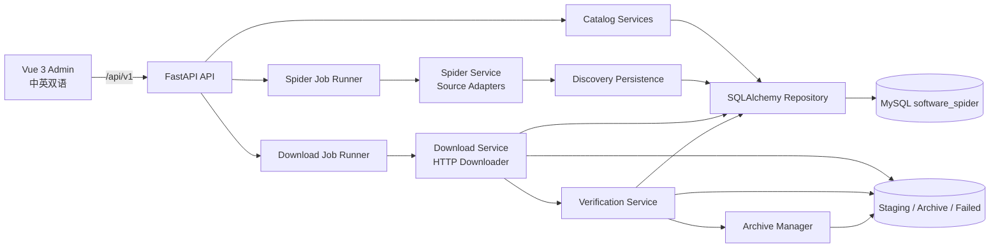
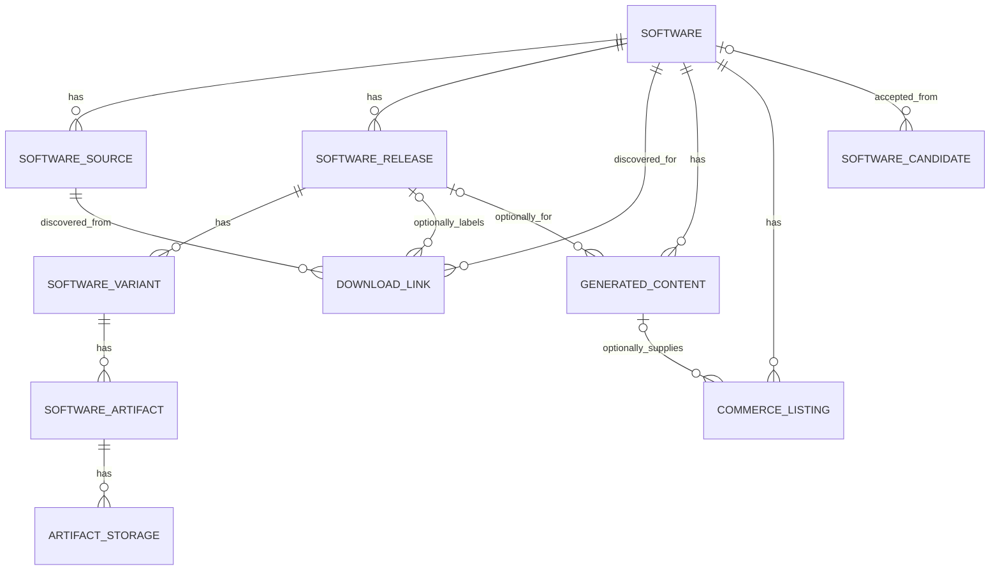

# software_spider 项目架构文档

> 文档基于 2026-10-07 的项目代码编写。范围为现有 Admin、Spider 与 HTTP 直链下载/验证能力；运行状态以实际启动和数据库检查为准。

## 1. 项目定位与当前范围

software_spider 是软件资源管理与发布系统的管理端。当前代码覆盖三条主线：维护软件目录；从公开来源发现版本、文件与网盘入口；将允许访问的 HTTP/HTTPS 直链文件下载、验证并归档。管理端还保存内容草稿、商品文案、存储位置等记录。真实网盘上传、AI 内容生成、商品自动发布和 Personal Website 联动尚未实现。

本项目保留严格的领域层级：**Software（软件产品）→ Release（版本）→ Variant（运行环境）→ Artifact（具体文件）**。网盘分享或下载页面属于 `DownloadLink`，不能因为发现了链接就推定其对应某个已经识别的安装包。软件文件下载成功也不代表拥有再次分发的权利；`redistribution_status` 独立保存，默认 `UNKNOWN`。

## 2. 总体架构



| 层次 | 实际技术与职责 |
| --- | --- |
| Admin Web | Vue 3、TypeScript、Vite、Element Plus、Vue Router；列表、表单、发现预览、下载进度、设置与中英切换。 |
| API | FastAPI + Pydantic；`/api/v1` 下的 CRUD、业务动作、分页/过滤和统一错误响应。 |
| 领域服务 | Candidate 接受、状态迁移、关联校验、发现结果入库、下载与人工审核。 |
| 异步任务 | 数据库 `jobs` 表保存任务；进程内受限线程池执行 Spider/Download/Verify。 |
| 数据持久化 | SQLAlchemy 2.x + PyMySQL；Alembic 管理迁移与 MySQL 表/列注释。 |
| 文件存储 | `DATA_ROOT` 下的 staging、archive、failed；数据库存相对文件路径。 |

API 不执行大文件同步下载；下载和验证由后台任务完成。Spider 只抓取页面/API/小体积元信息并结构化结果，不下载完整软件文件。

## 3. 目录与模块职责

```text
software_spider_admin/
├─ backend/
│  ├─ app/
│  │  ├─ api/             # /api/v1 路由
│  │  ├─ core/            # 配置、枚举
│  │  ├─ db/              # SQLAlchemy Base、Session
│  │  ├─ models/          # 数据表与关系
│  │  ├─ schemas/         # 请求/响应模型
│  │  ├─ repositories/    # 通用 CRUD、分页查询
│  │  ├─ services/        # 领域流程与设置
│  │  ├─ jobs/            # Spider / Download 任务执行器
│  │  ├─ spider/          # Adapter、HTTP、分类、URL/版本解析
│  │  ├─ downloader/      # 下载协议、安全策略、流式下载、暂存
│  │  ├─ verification/    # 文件类型、完整性、元信息、签名
│  │  ├─ storage/         # 本地归档
│  │  └─ ai/              # 后续扩展位置
│  ├─ migrations/         # Alembic 迁移链
│  └─ tests/              # 离线测试与小型 fixture
├─ admin-web/src/
│  ├─ api/ components/ layouts/ router/ types/ utils/ views/
│  └─ i18n.ts             # 中英双语文案
├─ docs/                  # Spider、Downloader 与本文档
├─ scripts/               # Windows 启动、探测与手动 seed 脚本
├─ skills/                # 内容生成技能预留目录
├─ data/                  # 项目内数据目录结构；实际位置由 DATA_ROOT 决定
├─ .env.example
└─ README.md
```

## 4. 数据模型与关联



| 实体 | 关键字段与规则 |
| --- | --- |
| `SoftwareCandidate` | 候选名称、来源与商业信号；接受后记录 `software_id`，避免重复收录。 |
| `Software` | 产品元信息；`slug` 唯一；删除优先改为 `ARCHIVED`。 |
| `SoftwareSource` | 来源 URL、来源类型、Adapter、优先级、启用状态、自动访问状态和最近检查结果。 |
| `SoftwareRelease` | `software_id + version` 唯一；版本状态独立管理。 |
| `SoftwareVariant` | 某版本的 OS、架构、版本分支、语言；同一版本可有多种环境。 |
| `SoftwareArtifact` | 某 Variant 的具体文件、直链、大小、校验值、下载/验证/再分发状态；一个 Variant 可有多个 EXE、MSI、ZIP 等。 |
| `DownloadLink` | 网盘分享、下载页面或直链入口，保留网盘服务商、提取码、页面文案及审核状态；可不绑定 Release。 |
| `ArtifactStorage` | Artifact 的 LOCAL/BAIDU 等存储位置记录；目前只实现管理模型与本地文件归档。 |
| `GeneratedContent` | 独立的网站、闲鱼、淘宝、版本通知草稿；不覆盖 `Software.description`。 |
| `CommerceListing` | 与 Software、可选 Release/草稿关联的商品记录；不执行自动发布。 |
| `Job` | 任务类型、目标类型/ID、状态、进度、错误、JSON payload/result 和时间；目标为多态引用。 |
| `SystemSetting` | 可编辑的非敏感配置覆盖值；数据库凭据与 Token 仍由 `.env` 管理。 |

所有业务表有创建/更新时间。主要外键采用 `RESTRICT`，避免误操作级联删除历史；Variant 和 Artifact 的业务去重由服务层处理，以便允许不同文件格式和来源。MySQL 表和列注释通过模型与 Alembic 维护。

## 5. 核心流程

### 5.1 候选收录

管理员创建 `SoftwareCandidate` → 审核并接受 → 服务层检查重复 → 创建或关联正式 `Software` → 候选状态变为 `ACCEPTED`，保存正式软件 ID。也可以直接创建 Software。

### 5.2 来源发现与入库

```text
SoftwareSource
  → CRAWL Job
  → SpiderService
  → SourceAdapterFactory
  → GitHub Release / Generic HTML / Static URL / JSON API Adapter
  → DiscoveryResult（Release、Variant、Artifact、DownloadLink、警告）
  → Preview（保存在 Job.result，不写正式目录）
  → 管理员确认 Import
  → DiscoveryPersistenceService 去重入库
```

`GITHUB_RELEASE` 调用公开 GitHub Releases API；`GENERIC_HTML` 解析页面链接及网盘入口；`STATIC_URL` 处理直接文件地址；`JSON_API` 提供通用 JSON 能力；`BROWSER` 和 `MANUAL` 当前为骨架/人工处理。所有 Adapter 输出统一候选结构，持久化逻辑集中处理。重复扫描应复用相同 Software 的版本、运行环境与文件。发现预览、版本检查与导入都接入 Job 中心。

### 5.3 直链下载、验证和归档

```text
Artifact（source_url 为允许的 HTTP/HTTPS 直链）
  → DOWNLOAD Job → HttpDownloader → staging/jobs/.../*.part
  → 完成大小与 SHA256/MD5 检查
  → VERIFY Job → VerificationService
     ├─ VERIFIED → archive/{slug}/{version}/{os}/{arch}/{filename}
     ├─ MANUAL_REVIEW → 暂存并等待人工审核
     └─ REJECTED → failed 目录
```

下载器按块流式写入文件，支持 Range 续传、重定向逐跳安全检查、超时/重试、大小与剩余空间限制、进度、取消。验证包含文件魔数、HTML 错误页识别、ZIP/TAR 完整性、可识别 PE 文件的架构/版本及 Windows 签名信号。无法可靠判定时进入人工审核。重复下载/重新下载不会静默覆盖已验证归档；内容 Hash 变化需要人工处理。网盘分享链接不能交给 HTTP 直链下载器当作安装包下载。

### 5.4 任务生命周期

`PENDING → RUNNING → SUCCESS / FAILED / CANCELLED`。Spider、Download、Verify 任务均在 `jobs` 表留存目标、阶段进度、结果和错误。下载执行器启动时处理上次中断的下载任务，并恢复待执行任务；进程内线程池限制并发。该实现适合当前单进程本地 Admin，不具备跨进程分布式队列能力。下载失败可以通过 Artifact 页面重新创建下载任务，并利用保留的 `.part` 文件尝试续传；若服务器不支持 Range，则从头下载。

## 6. API 设计

基础前缀：`/api/v1`。资源 `candidates`、`software`、`sources`、`releases`、`variants`、`artifacts`、`links`、`storage`、`content`、`listings`、`jobs` 提供分页列表、创建、详情；除 Job 外提供 PATCH 更新。列表支持 `page`、`page_size`、`search`、资源过滤及白名单 `sort`。错误结构为 `{ "error": { "code": 422, "message": "..." } }`。

| 路由 | 用途 |
| --- | --- |
| `GET /health` | 数据库连通性健康检查；完整地址为 `/api/v1/health`。 |
| `POST /candidates/{id}/accept`、`POST /software/{id}/archive` | 候选转正式软件、软件归档。 |
| `GET /software/{id}/releases`、`GET /software/{id}/sources` | 软件详情下的关联数据。 |
| `POST /sources/{id}/discover/preview`、`/discover/import`、`/check-release` | 来源发现、确认导入与版本检查；返回 Job。 |
| `POST /software/{id}/check-release`、`POST /software/check-releases` | 单个及批量版本检查。 |
| `POST /artifacts/{id}/download`、`/redownload`、`/verify` | 创建下载、重新下载、单独验证任务。 |
| `POST /artifacts/{id}/review/{decision}` | 人工批准或拒绝待审核文件。 |
| `POST /downloads/bulk`、`POST /jobs/{id}/cancel` | 批量建立每文件独立任务、取消任务。 |
| `GET /dashboard`、`GET/PATCH /settings`、`GET /lookups/{kind}` | 统计、可编辑非敏感设置、关联选择项。 |

Swagger 文档由 FastAPI 提供，默认 `http://127.0.0.1:8000/docs`。

## 7. Admin 页面与交互

| 路由 | 页面 |
| --- | --- |
| `/` | Dashboard 统计与最近任务。 |
| `/candidates` | 软件候选池；接受候选后显示关联软件 ID。 |
| `/software`、`/software/:id` | 已收录软件列表与详情；详情关联版本、来源、文件、存储、内容和发布记录。 |
| `/releases`、`/variants`、`/artifacts`、`/artifacts/:id` | 版本、运行环境、文件列表与文件详情；支持下载、验证、人工审核。 |
| `/sources`、`/links` | 抓取来源与发现的网盘/下载入口；来源可发起发现预览。 |
| `/downloads`、`/jobs`、`/jobs/:id` | 下载记录、任务中心与任务详情/错误。 |
| `/storage`、`/content`、`/publishing` | 存储位置、内容草稿、商品记录的管理。 |
| `/settings` | 数据库状态、本地路径、Spider 与 Downloader 等非敏感设置。 |

界面使用复用的表格、表单、状态标签和关系选择组件，右上角切换中文/English。前端时间以 `Asia/Shanghai` 显示。页面样式保持简洁，重点是管理动作和状态可见性。

## 8. 配置、运行与时间

- 项目根目录：`H:\allPro\software_spider\software_spider_admin`；Python 虚拟环境：项目内 `.venv`。
- 数据库：MySQL `192.168.0.106:3306/software_spider`；连接账号只在本地 `.env` 中配置，文档不包含账号或密码。
- 本机文件根目录：当前部署使用 `DATA_ROOT=F:/software_spider_bak`；系统设置可覆盖非敏感运行值。目录必须对 Backend 进程可写。
- 开发地址：Backend 默认 `http://127.0.0.1:8000`，Admin Web 默认 `http://localhost:5173`；实际地址以启动命令/终端输出为准。
- 时间：应用的 MySQL `DATETIME` 按北京时间存储，API 返回显式 `+08:00` 时间，前端按 `Asia/Shanghai` 显示。此约定不修改 Windows 系统时钟。
- 迁移：在 `backend` 目录使用 `..\.venv\Scripts\python.exe -m alembic upgrade head`；历史迁移不可删除，不能手工重建数据库。
- 其他可配置项见 `.env.example`：Spider 超时/重试/并发、可选 GitHub Token、私网 URL 策略、下载超时/并发/最大文件大小/域名策略。敏感值不通过 Settings API 返回。

## 9. 安全与功能边界

Spider 和 Downloader 分别校验 URL，只允许合适的 HTTP/HTTPS 资源，默认阻止本地、私网和 link-local 目标；Downloader 还逐跳检查重定向。无法自动访问、需登录或需验证码的来源进入人工处理，不实施 Token 伪造或访问控制绕过。文件先进入 staging，通过验证后才归档；扩展名与服务器返回值不能单独证明文件安全。管理端尚无用户认证/RBAC，应绑定本机地址并避免直接暴露到公网。当前没有真实网盘上传、自动发布、AI 接口或分布式任务队列。

## 10. 扩展接口与已知限制

`SourceAdapter`、`Downloader`、`ArtifactVerifier`、`StorageProvider`、`AIContentGenerator`、`CommercePublisher` 通过独立模块或 Protocol 预留职责。后续可增加厂商专用 Adapter、更成熟的下载 Worker、存储 Provider 与审核后的发布流程，同时保持 `Software → Release → Variant → Artifact` 不变。

当前下载器只处理直链 HTTP/HTTPS，不处理网盘分享页、Magnet 或 FTP。部分文件格式（例如 7Z 深度完整性、MSI 元信息）无法全面自动验证，可能落入人工审核。Windows 签名检查依赖运行环境。任务执行器是单进程实现，生产级多实例运行需要替换为持久队列并完善租约/重启恢复。URL 防护不等同于网络层 DNS 绑定，公网部署前还需要网络出口和身份认证控制。

更细的运行流程和测试命令参见项目根目录 `README.md`、`docs/spider.md` 与 `docs/downloader.md`。
